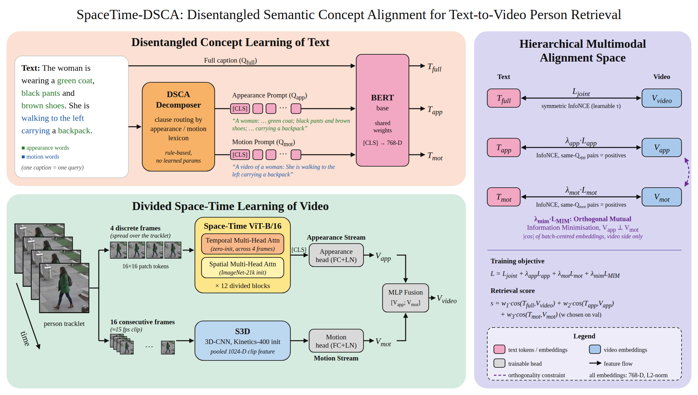

# SpaceTime-DSCA: Divided Space-Time Vision Transformer & Disentangled Semantic Concept Alignment for Text-to-Video Person Retrieval

Triển khai hoàn chỉnh kiến trúc mô hình **SpaceTime-DSCA (Divided Space-Time Vision Transformer with Disentangled Semantic Concept Alignment)** bằng PyTorch cho bài toán **Text-to-Video Person Retrieval (TVPR)** trên tập chuẩn **TVPReid** (`TVPReid-Duke`, `TVPReid-PRID`, `TVPReid-iLIDs`).

---

## 1. Cơ Sở Khoa Học: Chuyển Dịch Từ CLIP Sang Kiến Trúc Thuần ViT + BERT

### 1.1. Tại sao loại bỏ CLIP Pretrained để đảm bảo tính công bằng học thuật (Fair Comparison)?
Trong bài báo nền tảng **MFGF (ACM MM '24, `rootpaper.pdf`)**, tác giả sử dụng kiến trúc chuẩn gồm **Vision Transformer (ViT)** kết hợp **S3D (Separable 3D-CNN)** và **BERT Text Encoder** được huấn luyện trực tiếp trên tập dữ liệu TVPR, đạt Rank@1 trên tập test lần lượt **32,3% / 30,0% / 35,2%** trên `TVPReid-PRID` / `TVPReid-iLIDs` / `TVPReid-Duke`.

Khi một nghiên cứu sử dụng **OpenAI CLIP** (`openai/clip-vit-base-patch16` đã pre-train trên 400 triệu cặp Text-Image ngoài luồng):
1. **Bị hội đồng bình duyệt (Reviewers) đặt nghi vấn**: Rất khó chứng minh sự vượt trội đến từ *đóng góp kiến trúc đề xuất* hay chỉ đơn thuần là hưởng lợi từ tập dữ liệu khổng lồ 400M ảnh của OpenAI.
2. **Khủng hoảng sụp đổ ngữ nghĩa (Semantic Collapse) của luồng chuyển động**:
   - Khi tách câu truy vấn thành $Q_{app}$ và $Q_{mot}$, trong bài toán Re-ID hầu hết các mô tả chuyển động đều bị suy biến thành các chuỗi văn bản trùng lặp: *"a person is walking"*, *"someone moving forward"*.
   - CLIP Text Encoder ánh xạ các mô tả này thành các vector gần như giống hệt nhau, khiến hàm mất mát tương phản InfoNCE bị kẹt tại $\ln(\text{Batch Size}) \approx 2.77$ vì phạt các mẫu âm tính có nhãn văn bản giống hệt nhau.
   - Phép trừ khung hình $\Delta F_t$ triệt tiêu đến 90% điểm ảnh, khi đi qua Average Pooling làm loãng hoàn toàn tín hiệu gradient.

### 1.2. Bản chất của "Chuyển động" trong Text-to-Video Person Retrieval (TVPR)
Phân tích sâu từ bài báo gốc cho thấy: **Trong TVPR, "chuyển động" (Motion) không phải là bài toán phân loại hành động (Action Recognition như chạy nhảy, đá bóng), mà là Động lực học Không - Thời gian (Spatio-Temporal Dynamics)**:
* **Sự thay đổi góc nhìn theo thời gian (Viewpoint Evolution)**: Khi người đi qua camera an ninh, họ quay từ trước mặt $\to$ nghiêng góc $\to$ nhìn từ phía sau, để lộ các đặc trưng bị che khuất (balo, logo sau áo, túi xách).
* **Phục hồi sau che khuất (Temporal Occlusion Recovery)**: Một phần cơ thể bị người khác hoặc vật cản che khuất ở frame $t_1$ nhưng xuất hiện rõ nét ở frame $t_2$.
* **Đặc trưng quỹ đạo và sải bước (Trajectory & Stride Dynamics)**: Tốc độ di chuyển và phương hướng tương đối đối với góc đặt camera.

---

## 2. Tập Dữ Liệu Chuẩn TVPReid & Ý Nghĩa 3 Sub-datasets

### 2.1. Nguồn gốc lịch sử hình thành TVPReid
* Trước khi có **TVPReid**, các bộ dữ liệu Re-ID bằng văn bản (*CUHK-PEDES*, *ICFG-PEDES*, *RSTPReid*) **chỉ có hình ảnh tĩnh 2D**, hoàn toàn thiếu thông tin chuỗi thời gian và dáng đi.
* Trong khi đó, ở nhánh **Video Re-ID**, cộng đồng thị giác máy tính đã có sẵn 3 tập chuẩn video giám sát kinh điển:
  1. **iLIDS-VID** (2014)
  2. **PRID-2011** (2011)
  3. **DukeMTMC-VideoReID** (2018)
* Cả 3 tập này nguyên bản **chỉ có video, không hề có văn bản mô tả (captions)**. Nhóm tác giả bài báo MFGF (ACM MM '24) đã thực hiện một khối lượng công việc lớn: **gán nhãn thủ công 2 câu mô tả chi tiết bằng ngôn ngữ tự nhiên cho từng video** (trang phục, màu sắc, phụ kiện, hướng đi, hành động), tổng cộng **13.118 câu mô tả cho 6.559 clip video**, tạo ra benchmark đa phương thức Text-to-Video đầu tiên mang tên **TVPReid**.

### 2.2. Bốn lý do khoa học tại sao tác giả chia thành 3 sub-datasets riêng biệt

#### ① Tính chuẩn mực và kế thừa khoa học (Benchmark Consistency & Fair Comparison)
Trong cộng đồng nghiên cứu thị giác máy tính quốc tế (CVPR, ICCV, ACM MM), cả 3 tập dữ liệu trên đã có **quy chuẩn phân chia tập train/test cố định** từ nhiều năm qua. Việc duy trì 3 sub-datasets độc lập giúp:
* So sánh trực tiếp, công bằng (*fair comparison*) với các nghiên cứu tiền nhiệm.
* Đảm bảo tính toàn vẹn, loại trừ nguy cơ rò rỉ thông tin danh tính giữa các góc camera (*data leakage*).

#### ② Ba kịch bản giám sát thực tế với thách thức thị giác hoàn toàn khác biệt

| Sub-dataset | Bối cảnh giám sát | Số Camera | Thách thức thị giác chính |
| :--- | :--- | :---: | :--- |
| **`TVPReid-iLIDs`** | **Trong nhà (Sảnh đến sân bay)** | 2 | **Che khuất nặng nề (Severe Occlusion)**: Người đi lại đông đúc, chen chúc, hành lý, xe đẩy và cột nhà liên tục che khuất đối tượng. |
| **`TVPReid-PRID`** | **Ngoài trời (Lối đi bộ pathway)** | 2 | **Góc nhìn lệch cực lớn (Extreme Viewpoint Variations)**: Góc quay giữa 2 camera tĩnh chênh lệch rất cao, ánh sáng bóng râm/nắng gắt làm thay đổi sắc độ quần áo. |
| **`TVPReid-Duke`** | **Đại học diện rộng (Campus)** | 8 | **Quy mô lớn & Không gian phức tạp (Large-scale Multi-camera)**: 8 camera rải khắp khuôn viên, khoảng cách camera xa, thời gian di chuyển giữa các camera dài. |

#### ③ Kiểm thử trên 3 mức quy mô dữ liệu (Data Scales)
* **`TVPReid-iLIDs` (Quy mô nhỏ - 300 IDs, 1.200 captions, ~600 videos)**: Thử nghiệm khả năng học trong điều kiện **ít dữ liệu** (*Low-data regime*), đo lường mức độ chống học vẹt (*overfitting*).
* **`TVPReid-PRID` (Quy mô vừa - 385 IDs, 2.268 captions, ~1.134 videos)**: Cân bằng giữa ngoại hình và biến thiên chuyển động.
* **`TVPReid-Duke` (Quy mô lớn - 1.404 IDs, 9.650 captions, ~4.825 videos)**: Thử thách khả năng tìm kiếm trong **Gallery khổng lồ** (hàng trăm/nghìn người), kiểm tra xem mô hình có giữ được Rank@1 khi không gian tìm kiếm bị loãng hay không.

#### ④ Đo lường tính khái quát hóa và độ ổn định đa miền (Generalization Robustness)
Một mô hình Text-to-Video Person Retrieval xuất sắc **không được phép phụ thuộc vào một góc quay hay điều kiện chiếu sáng duy nhất**. Việc mô hình hoạt động vượt trội đồng thời trên cả 3 sub-datasets chứng minh kiến trúc có tính tổng quát hóa cao, đáp ứng môi trường giám sát an ninh thực tế.

---

## 3. Kiến Trúc Mô Hình SpaceTime-DSCA



Hình trên vẽ đúng cấu hình đã cho ra mọi số liệu ở Mục 4–5: backbone video `mfgf` với recipe `m3`. Nguồn của hình là `reports/framework_v2.html`; mở file đó bằng Chrome để sửa rồi chụp lại. Code còn giữ backbone cũ `spacetime` (mặc định khi không truyền `--backbone`), mô tả ở cuối mục này.

Luồng dữ liệu: `data/dataset.py` → `models/damr_main.py::DAMRModel` → `loss/criterion.py::DAMRCriterion`; đánh giá ở `experiments/common.py` và `utils/metrics.py`.

### ① Nhánh văn bản: DSCA + BERT dùng chung
* **DSCA Decomposer** (`data/text_decomposer.py`) chạy trong `__getitem__` và không có tham số học. Nó tách caption thành:
  - $Q_{app}$: các mệnh đề về ngoại hình (màu sắc, quần áo, phụ kiện);
  - $Q_{mot}$: các mệnh đề về chuyển động (động từ, hướng đi).

  Có hai chế độ:
  - `keyword` (mặc định): ghép các từ khóa rời;
  - `clause` (recipe m3): giữ nguyên cả mệnh đề, nên "short black hair" hay "a book in her hand" không bị mất. Một mệnh đề có thể vào cả hai prompt.
* **Một BERT-base-uncased dùng chung** (`models/text_encoder.py`) mã hóa ba chuỗi: caption gốc → $T_{full}$, $Q_{app}$ → $T_{app}$, $Q_{mot}$ → $T_{mot}$. Cả ba đều lấy token `[CLS]`, 768-D.

### ② Nhánh video: Space-Time ViT + S3D (`models/mfgf_video.py`)
Mỗi tracklet được lấy mẫu theo hai nhịp. Đầu vào là `[B, 20, 3, 224, 224]`, sinh bởi `frame_layout="mfgf"` trong dataset.

| Luồng | Đầu vào | Bộ mã hóa | Đầu ra |
| :--- | :--- | :--- | :--- |
| Appearance | 4 khung rời, trải đều tracklet | Space-Time ViT-B/16, 12 block chia tách (`models/frozen_vit.py`): temporal attention khởi tạo 0, rồi spatial attention khởi tạo ImageNet-21k (timm) | `[CLS]` → head (FC+LN) → $V_{app}$ |
| Motion | 16 khung liên tiếp (≈15 fps) | S3D, khởi tạo Kinetics-400 (torchvision), BatchNorm đóng băng | đặc trưng 1024-D → head (FC+LN) → $V_{mot}$ |
| Fused | $[V_{app}; V_{mot}]$ | MLP Fusion | $V_{video}$ |

Tất cả embedding đều 768-D và được chuẩn hóa L2.

Bộ mã hóa video giống MFGF (ViT 4 khung + S3D 16 khung), nên phép so sánh là công bằng. Phần khác biệt nằm ở DSCA, ba luồng căn chỉnh riêng và $\mathcal{L}_{MIM}$.

### ③ Hàm mất mát (`loss/criterion.py`, `models/mim_loss.py`)
$$\mathcal{L} = \mathcal{L}_{joint}(T_{full}, V_{video}) + \lambda_{app}\,\mathcal{L}_{app}(T_{app}, V_{app}) + \lambda_{mot}\,\mathcal{L}_{mot}(T_{mot}, V_{mot}) + \lambda_{mim}\,\mathcal{L}_{MIM}$$

* Mỗi số hạng $\mathcal{L}_{\cdot}$ là InfoNCE đối xứng (text→video và video→text). Với `--learnable_tau`, nhiệt độ τ được học.
* Với `--text_pos`, các mẫu trong batch có cùng chuỗi $Q_{app}$/$Q_{mot}$ được tính là positive. Không làm vậy thì các $Q_{mot}$ gần trùng nhau ("A video of a woman walking") bị phạt như mẫu âm.
* $\mathcal{L}_{MIM} = \frac{1}{B}\sum_i |\cos(V_{app,i}, V_{mot,i})|$ chỉ áp lên phía video. Với `--mim_mode centered`, trung bình batch được trừ trước khi tính cosine, để chỉ phần riêng của từng mẫu bị ép trực giao.
* Hệ số mặc định lấy từ `configs/default.yaml` (λ_app 0.5, λ_mot 0.25, λ_mim 0.1); đổi bằng `--lambda_app`, `--lambda_mot`, `--lambda_mim`.

### ④ Chấm điểm khi truy hồi
$$s(Q, V) = w_1\cos(T_{full}, V_{video}) + w_2\cos(T_{app}, V_{app}) + w_3\cos(T_{mot}, V_{mot})$$

Bộ trọng số $(w_1, w_2, w_3)$ được tìm bằng lưới (`--grid_step 0.1` với m3) **trên tập validation** của từng lần chạy. Tập test chỉ chấm một lần với bộ trọng số đã chọn.

Gallery được khử trùng lặp theo `video_id`, vì mỗi video có 2 caption. Giao thức MFGF dùng 1 caption/video, với gallery test gồm 142 (PRID), 75 (iLIDs) và 603 (Duke) video.

### ⑤ Các recipe huấn luyện (`experiments/plan.py`)

| Recipe | Nội dung |
| :--- | :--- |
| `m2s` | `--backbone mfgf` + cờ v2 (`--unique_video_batches --learnable_tau --weight_decay 0.05 --select_metric mean_r1_5_10`); mỗi tập con train riêng như MFGF |
| `m3` | `m2s` + `--clip_flip --text_pos --dsca_mode clause --temporal_head_lr --mim_mode centered --ema 0.99` (lý do của từng cờ: `experiments/kaggle/HUONG_DAN_M3.md`) |
| `m3j` | `m3`, nhưng train chung trên `all` 6 epoch rồi fine-tune từng tập con |
| `m3c` | `m3j` có thêm bước pre-train text–image trên CUHK-PEDES (`experiments/pretrain_cuhk.py`). **Đây là dữ liệu ngoài**, nên phải ghi rõ khi so với MFGF |

### Backbone cũ `spacetime` (`models/spacetime_vit.py`)
Đây là ViT kiểu TimeSformer với 6 block, 16 khung đều nhau, spatial layer nạp ImageNet-1K. Các luồng ra:
- $V_{app}$ = attention pooling theo thời gian;
- $V_{mot}$ = Bi-GRU;
- $V_{video}$ = MLP fusion.

Backbone này dùng cho các run v1/v2. Nó kém hơn `mfgf` (PRID v2: test R@1 38,7) nên không còn là cấu hình chính. `test.py` vẫn dựng cứng kiến trúc này; với checkpoint `mfgf`, hãy dùng `experiments/run_revision.py` hoặc web demo, vì hai công cụ này đọc kiến trúc từ checkpoint.

---

## 4. Ablation (`TVPReid-PRID`, recipe m3, tập test, giao thức MFGF)

Mọi con số dưới đây được tính lại từ `results/v8` và `results/v9` (`results/v*/results/runs/TVPReid-PRID/*.json`). Đơn vị là R@K (%). Tập test có 142 truy vấn, nên mỗi truy vấn ≈ 0,7 điểm.

### 4.1. Bỏ từng thành phần (leave-one-out)

| Cấu hình | Seed 42: R@1 / R@5 / R@10 / MdR | Seed 1234: R@1 / R@5 / R@10 / MdR |
| :--- | :---: | :---: |
| **Full (m3)** | **57,7** / 83,8 / 92,3 / 1 | **59,2** / 87,3 / 94,4 / 1 |
| − pretrained init | 16,9 / 49,3 / 64,8 / 6 | – |
| − temporal attention | 45,8 / 76,8 / 88,0 / 2 | 57,7 / 85,9 / 92,3 / 1 |
| − DSCA (T_app = T_mot = T_full) | 52,8 / 83,1 / 93,0 / 1 | 58,5 / 89,4 / 96,5 / 1 |
| − L_MIM | 51,4 / 82,4 / 91,5 / 1 | 56,3 / 86,6 / 95,1 / 1 |

### 4.2. Cộng dồn (seed 42)

| Bước | R@1 | R@5 | R@10 | MdR |
| :--- | :---: | :---: | :---: | :---: |
| cum1: baseline (ViT khởi tạo ngẫu nhiên, chỉ T_full) | 12,7 | 44,4 | 59,2 | 7 |
| cum2: + pretrained init | 53,5 | 83,1 | 90,8 | 1 |
| cum3: + divided space-time attention | 55,6 | 84,5 | 90,1 | 1 |
| + DSCA (= no_mim) | 51,4 | 82,4 | 91,5 | 1 |
| + L_MIM (= full) | 57,7 | 83,8 | 92,3 | 1 |

### 4.3. Đọc kết quả một cách trung thực
* Mô hình full cao nhất ở R@1 trong mọi cặp bỏ-một-thành-phần, ở cả hai seed. Nhưng ở R@5/R@10, `no_dsca` và `no_mim` có lúc cao hơn full.
* Chỉ khoảng cách **no_temporal ở seed 42** có khoảng tin cậy bootstrap ghép cặp không chứa 0 (+3,5 đến +21,1). Các khoảng cách ở seed 1234 (0,7–2,8 điểm) đều nằm trong nhiễu.
* Nhiễu giữa các lần chạy lớn: cùng seed 42 và cùng code, PRID full ra 52,8 ở Kaggle v1 và 57,7 ở v2.
* Ở bảng cộng dồn, bước "+DSCA" làm R@1 giảm (55,6 → 51,4). Chỉ khi thêm L_MIM, R@1 mới lên mức cao nhất.

---

## 5. So Sánh Với MFGF (ACM MM '24) — tập test, giao thức MFGF

Định dạng ô: R@1 / R@5 / R@10 / R@50 / MdR. Trung bình được lấy qua các seed.

| Tập con | MFGF | SpaceTime-DSCA | Recipe, số seed | Nguồn |
| :--- | :---: | :---: | :--- | :--- |
| PRID | 32,3 / 76,3 / 85,1 / 100 / 2 | **58,5** / **85,6** / **93,4** / 99,3 / 1 | m3, 2 seed (42, 1234) | `results/v8` |
| iLIDs | 30,0 / **71,7** / **91,7** / 100 / 4,7 | **38,2** / 69,8 / 84,9 / 100 / 2,3 | m3c, 3 seed (chọn trên val) ¹ | `results/v8` |
| Duke | 35,2 / 62,2 / 84,0 / 90,4 / 3 | **47,6** / **75,6** / **84,5** / **94,5** / 2 | m2s, 3 seed | `results/v6` |

¹ m3c dùng pre-train CUHK-PEDES (dữ liệu ngoài). Hai lựa chọn không dùng dữ liệu ngoài trên iLIDs:
- m3j: 41,3 / 69,8 / 84,0 (3 seed);
- m3: 32,9 / 63,6 / 81,3 (3 seed).

Quy tắc chọn trên val đã chọn m3c (val 85,74 so với m3j 84,38, `results/ilids_m3c_selection.json`).

**Hạn chế còn lại:**
- R@5 và R@10 của iLIDs vẫn thấp hơn MFGF ở mọi cấu hình đã thử.
- Duke chưa được chạy với m3.
- Các giá trị iLIDs của MFGF là bội số của 1/60 và MdR lẻ, nên nhiều khả năng là trung bình của nhiều lần chạy. Bài MFGF không công bố code để kiểm chứng.

| Tiêu chí | MFGF | SpaceTime-DSCA |
| :--- | :--- | :--- |
| Bộ mã hóa video | Frozen-in-Time ViT (4 khung) + S3D (16 khung) | Như MFGF (backbone `mfgf`) |
| Văn bản | BERT + gợi ý luật NLTK ($D^2$ tips) | BERT dùng chung + DSCA tách $Q_{app}$ / $Q_{mot}$ theo mệnh đề |
| Căn chỉnh | Ghép đặc trưng hình ảnh và chuyển động | 3 InfoNCE riêng (joint / app / mot) + ép trực giao $V_{app} \perp V_{mot}$ |
| Chấm điểm | Một điểm toàn cục | Tổng có trọng số của 3 cosine, trọng số chọn trên val |

---

## 6. Hướng Dẫn Sử Dụng

> Cài đặt (Linux/Windows), tải checkpoint, chạy web demo và deploy (Docker, AWS EC2 + CI/CD): xem **[INSTALL.md](INSTALL.md)**.

Dữ liệu được tìm theo thứ tự `--data_root`, rồi biến môi trường `DATA_ROOT`, rồi `../dataset`, `./dataset`, `/content/dataset`… Mỗi tập con cần có thư mục `captions/` chứa `train.csv`, `val.csv`, `test.csv` (cột `video_id`) và các file `*.json`. **Nếu không tìm thấy caption, dataset sẽ âm thầm tạo dữ liệu giả** (32 train / 16 val); số liệu vô nghĩa thì kiểm tra điều này trước.

### 6.1. Huấn luyện
```bash
# Recipe m3 trên PRID, đúng như run trong bảng (seed 42)
PBL_NO_FROZEN=1 python train.py --sub_dataset TVPReid-PRID --tag m3_seed42 --seed 42 --backbone mfgf \
    --unique_video_batches --learnable_tau --weight_decay 0.05 --select_metric mean_r1_5_10 \
    --clip_flip --text_pos --dsca_mode clause --temporal_head_lr --mim_mode centered --ema 0.99

# Tiếp tục một run bị ngắt
python train.py --sub_dataset TVPReid-PRID --tag m3_seed42 --resume latest

# Ablation: thêm --no_temporal_attn, --no_dsca, --lambda_mim 0 hoặc --no_pretrained_vit
```
Checkpoint được lưu ở `checkpoints/<tập con>/<tag>/{best,latest}.pth`, lịch sử train ở `reports/<tập con>/`. Backbone `mfgf` tải trọng số ViT timm và S3D torchvision ở lần đầu. `PBL_NO_FROZEN=1` bỏ qua checkpoint Frozen-in-Time (2 GB, server Oxford hay timeout) và dùng ViT ImageNet-21k; mọi run trong bảng đều chạy như vậy.

### 6.2. Toàn bộ quy trình thực nghiệm (nhiều seed, ablation, bảng cho bài báo)
```bash
python experiments/run_revision.py --stage train  --recipe m3 --subs TVPReid-PRID --seeds 42 1234 --data_root ../dataset
python experiments/run_revision.py --stage encode --recipe m3 --data_root ../dataset
python experiments/run_revision.py --stage eval   --recipe m3 --grid_step 0.1   # chọn trọng số trên val, chấm test một lần
python experiments/run_revision.py --stage aggregate
```
`--dry_run` in ra các lệnh sẽ chạy mà không thực thi. Chi tiết ở `experiments/README.md`. Notebook Kaggle 2×T4 nằm ở `experiments/kaggle/`.

### 6.3. Đánh giá nhanh bằng `test.py` (chỉ dành cho checkpoint backbone `spacetime`)
```bash
python test.py --sub_dataset TVPReid-PRID --checkpoint checkpoints/TVPReid-PRID/best.pth --confusion_matrix --cm_size 10
python test.py --sub_dataset TVPReid-PRID --sweep                         # quét trọng số fusion / TTA / hubness
python test.py --sub_dataset TVPReid-PRID --query "A man in a dark grey jacket walking away"
python test.py --sub_dataset TVPReid-PRID --dashboard                     # vẽ lại dashboard từ lịch sử train
```

### 6.4. Web demo
```bash
python web_demo.py --port 8000 --samples_dir samples
```
Bản đang chạy: **https://findperson.duckdns.org**. Cần đăng nhập, và chỉ vào được khi máy EC2 đang bật.

Web demo gồm hai bước:
1. **Phân tích:** chạy một lần cho mỗi video, tốn thời gian.
2. **Tìm kiếm:** chạy mỗi lần gõ câu mô tả, gần như tức thì.

```
Tải video ─► Proxy H.264 720p ─► [Phân tích, 1 lần] ─► chỉ mục trong RAM ─► [Tìm kiếm, mỗi câu] ─► xếp hạng + timeline
```

**Phân tích** (`webapp/engine.py::SearchEngine.analyze`):

| Bước | Model | Việc |
| :--- | :--- | :--- |
| ① Phát hiện + theo vết | YOLOv8n (960px) + BoT-SORT | Bám từng người qua mọi frame; mỗi 0,25 s lấy một mẫu re-ID |
| ② Tách track sai | OpenVINO re-ID `0277` | Cắt track khi khung nhảy sang người khác |
| ③ Cắt ảnh | | 20 khung cho mỗi người theo layout `mfgf`, ưu tiên khung ít bị che |
| ④ Thuộc tính | PA-100K (PaddleClas PULC) + OpenVINO attributes + YOLOv8n-pose | Giới tính, mũ, balo, túi, quần dài, quần ngắn, váy/đầm, áo khoác dài, tóc dài; màu áo và quần; tư thế ngồi |
| ④b Đồ vật đi cùng | YOLOv8n (cùng lượt với bước ①) | Vali và túi xách được gắn vào người gần nhất ở từng khung; tỉ lệ thời gian đi cùng → xác suất "có vali", "xách túi" |
| ⑤ Nối track | Re-ID | Nối hai đoạn của cùng một người sau khi bị che, tối đa 8 s |
| ⑥ CLIP | CLIP ViT-B/16 | Embedding ảnh cho nhánh CLIP ẩn |
| ⑦ Mã hóa | **SpaceTime-DSCA (m3c)** | Tạo $V_{app}$, $V_{mot}$, $V_{video}$ cho từng người |
| ⑧ Hành động | | Đứng / đi / chạy tính từ tốc độ khung; ngồi tính từ tư thế; hướng đi (trái/phải, về phía/ra xa camera) từ quỹ đạo khung |

Bước ⑤ chạy trước ⑥ và ⑦, nên mỗi người chỉ được mã hóa một lần.

**Tìm kiếm:** câu truy vấn được tách bằng DSCA và mã hóa bằng BERT, rồi tính điểm cuối:
$$\text{điểm} = \frac{0{,}45\cos(T_{full},V_{video}) + 0{,}45\cos(T_{app},V_{app}) + 0{,}09\cos(T_{mot},V_{mot}) + 0{,}2\,\text{CLIP}}{1{,}2} - \text{phạt thuộc tính}$$
- Ba trọng số DSCA được chuẩn hoá để cộng lại bằng 1.
- *Phạt thuộc tính* là $\sum w\,(1-p)$, lấy từ các ràng buộc đọc ra trong câu (màu quần, túi, balo, mũ, quần dài/ngắn, váy, áo khoác dài, vali, hành động, hướng đi) so với thuộc tính đã đo. Giới tính và màu áo vẫn được nhận diện và hiện trên giao diện nhưng không tính vào điểm: đo trên TVPReid và video thật, DSCA + CLIP đã xử lý tốt hai thứ này, thêm ràng buộc chỉ làm giảm độ chính xác.
- Nhánh CLIP và phần thuộc tính chỉ có trong demo, **không** dùng cho số liệu bài báo.
- Trên hai video tự gán nhãn (24 câu), CLIP đưa số câu đúng ở hạng 1 từ 7/9 lên 8/9 và từ 12/15 lên 15/15.

**Speed mode** đang bật (trên CPU):
- CLIP chỉ dùng 1 ảnh cho mỗi người;
- bộ mã hóa video chạy int8.

Đổi lại, mỗi video tự gán nhãn mất tối đa 1 câu đúng ở hạng 1. Muốn tắt, đặt `CLIP_CROPS = 3` và `ENCODER_INT8 = False` trong `webapp/engine.py`.

Checkpoint khuyến nghị là `best.pth` ở [release v2.0](https://github.com/NguyenChien510/pblcv/releases/tag/v2.0), tức recipe m3c; xem INSTALL.md. Chi tiết kỹ thuật của web xem `CLAUDE.md`.

### 6.5. Deploy và CI/CD

Mỗi lần push lên `main` có sửa code app, GitHub Actions tự build Docker image và cập nhật server:

```
git push ─► GitHub Actions: build image ─► ghcr.io/nguyenchien510/pblcv-webdemo:<commit>
                         └─► SSH vào EC2 ─► pull, chạy lại, chờ app trả lời (lỗi thì quay về bản trước)
```

- **Server:** AWS EC2 `c7i.4xlarge` (16 vCPU, 32 GB) ở Singapore, sau Caddy (HTTPS tự động và mật khẩu chung).
- **Tên miền:** DuckDNS miễn phí, tự trỏ về IP mới mỗi lần bật máy.
- **Hướng dẫn:**
  - từng bước, gồm cả truy cập SSH: [INSTALL.md](INSTALL.md) mục 6;
  - VPS thường và Google Cloud GPU: mục 4 và 5.

---

## 7. Cấu Trúc Thư Mục

| Đường dẫn | Nội dung |
| :--- | :--- |
| `train.py`, `test.py` | Huấn luyện, đánh giá nhanh |
| `configs/default.yaml` | Siêu tham số mặc định (cờ CLI ghi đè) |
| `data/` | `dataset.py` (lấy mẫu khung, hai layout `uniform`/`mfgf`), `text_decomposer.py` (DSCA) |
| `models/` | `damr_main.py` (DAMRModel), `text_encoder.py`, `mfgf_video.py` + `frozen_vit.py` (backbone chính), `spacetime_vit.py` (backbone cũ), `mim_loss.py` |
| `loss/criterion.py` | InfoNCE ×3 + L_MIM |
| `experiments/` | Quy trình nhiều seed/ablation, bootstrap CI, hình và bảng cho bài báo, notebook Kaggle |
| `results/` | Kết quả thật theo từng đợt chạy (`v6`…`v9`), CI, file chọn cấu hình trên val |
| `webapp/`, `web_demo.py` | Web demo (FastAPI + giao diện tĩnh) |
| `deploy/` | Docker + Caddy, override GPU, script cài EC2 (`ec2-setup.sh`) và script deploy (`remote-deploy.sh`) |
| `.github/workflows/deploy.yml` | CI/CD: build image lên GHCR, deploy lên EC2 |
| `reports/` | Hình kiến trúc, lịch sử train, dashboard |
